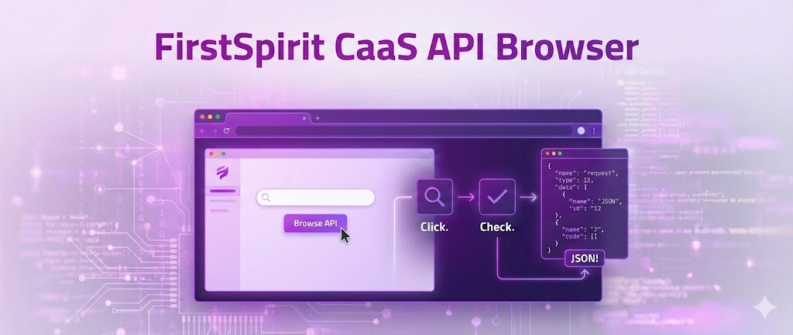

# FirstSpirit CaaS API Browser

A beginner-friendly web interface for exploring and interacting with the FirstSpirit CaaS API. This tool provides an intuitive UI approach to browse, test, and understand CaaS API endpoints without the need of deep technical knowledge.

## Features

- **Setup wizard:** paste a CaaS URL and the customer, stage and project are filled in for you. The project's locales are discovered automatically, and the API keys are tested before saving.
- **Multiple projects:** switch between customers and projects with the project picker. Add, edit and remove them in the **Manage Projects** dialog.
- **Preview and release:** each project has its own API key per mode.
- **CaaS requests:** filter by type (PageRef, Dataset, Media, GCAPage, ProjectSettings), then by name, identifier or SEO route, or by schema and entity type for datasets. Paging, locale, `rep` and `count` are also available. Available data types are discovered from the CaaS.
- **Navigation Service:** query the full navigation, a single SEO route or a page by ID, in the `default`, `noLinks` or `caas` format, with an optional depth. The service URL is derived from the CaaS URL.
- **Response view:** browse responses as a tree or as raw JSON, and copy the JSON or the request URL. Very large responses are shown as a preview first.
- **Update check:** see whether a newer release is available.
- **Languages:** English, German and Italian.

## Getting Started

### Prerequisites

- Node.js 24 (LTS) or higher, as specified in `.nvmrc` and `package.json`
- Access to a FirstSpirit CaaS API endpoint

### Installation

1. Clone the repository:

```bash
git clone git@github.com:e-Spirit-Usergroup/firstspirit-caas-api-browser.git
cd firstspirit-caas-api-browser
```

2. Install dependencies:

```bash
npm install
```

3. Start the development server:

```bash
npm run dev
```

4. Open your browser and navigate to `http://localhost:5173`

### Build & Deploy

Build for production:

```bash
npm run build
```

The output is a static site in `dist/`. Preview the production build locally:

```bash
npm run preview
```

Deploy by serving the `dist/` folder with any static file server (Nginx, Apache, Caddy, Vercel, Netlify, etc.).

## Configuration

The application stores its configuration in the browser's localStorage. You can configure your project through the setup wizard or by uploading a JSON configuration file.

Configurations can be exported and imported as encrypted JSON files via the **Manage Projects** dialog. API keys are encrypted with AES-GCM using a password you provide during export. Files exported by older versions can still be imported; their single API key becomes the preview key.

**Security note:** API keys are currently stored in plaintext in localStorage. Only use this tool on trusted devices. Exported configuration files encrypt the API keys, but the keys remain unencrypted in the browser's localStorage while the application is in use.

## Project Structure

```
src/
├── components/     UI and feature components (Base UI / shadcn-style)
├── lib/            Business logic (CaaS requests, config, crypto)
├── routes/         TanStack Router file-based routes
├── stores/         Zustand persisted stores
├── types/          Shared TypeScript types
public/
└── locales/        i18n translation files (en, de, it)
```

## Scripts

<!-- AUTO-GENERATED from package.json scripts -->
| Command | Description |
|---------|-------------|
| `npm run dev` | Start the Vite development server with hot reload |
| `npm run build` | Type-check (`tsc -b`) and build the production bundle into `dist/` |
| `npm run preview` | Serve the production build locally |
| `npm run lint:format` | Run Biome and auto-fix lint and formatting issues |
| `npm run route:generate` | Regenerate the TanStack Router route tree (`src/routeTree.gen.ts`) |
| `npm run route:watch` | Regenerate the route tree on every route file change |
<!-- END AUTO-GENERATED -->

## Code Quality

This project uses [Biome](https://biomejs.dev/) for formatting, linting, and import organization. Run `npm run lint:format` before committing.

## Tech Stack

- **Runtime:** React 19, TypeScript 5.9
- **Build:** Vite 8
- **Routing:** TanStack Router (file-based, auto code-splitting)
- **State:** Zustand (persisted to localStorage)
- **Styling:** Tailwind CSS 4, Base UI primitives (shadcn/ui)
- **Forms:** React Hook Form + Zod
- **i18n:** i18next (English, German, Italian)

## Core Authors & Maintainers

**Kevin Rieger** - [k.rieger@reply.de](mailto:k.rieger@reply.de) - [Neo Reply](https://neoreply.de)

**Felix Kratz** - [f.kratz@reply.de](mailto:f.kratz@reply.de) - [Neo Reply](https://neoreply.de)

**Stephanie Walter** - [st.walter@reply.de](mailto:st.walter@reply.de) - [Neo Reply](https://neoreply.de)

## License

This project is licensed under the GNU General Public License v3.0 - see the [LICENSE](LICENSE) file for details.

Copyright (c) 2026 Neo Reply